<p align="center">
  
</p>

<p align="center">
  <a href="https://github.com/ishandutta2007/Awesome-Awssome-Awesome"></a>
  <a href="https://discord.gg/jc4xtF58Ve"></a>
  <a href="https://opensource.org/licenses/MIT"></a>
  <a href="https://github.com/ishandutta2007/Awesome-Multi-Currency-Autonomous-Bookkeeping/stargazers"></a>
  <a href="https://github.com/ishandutta2007/Awesome-Multi-Currency-Autonomous-Bookkeeping/network/members"></a>
  <a href="https://github.com/ishandutta2007/Awesome-Multi-Currency-Autonomous-Bookkeeping/pulls"></a>
  <a href="https://github.com/ishandutta2007"></a>
</p>

---

# 🌐 Awesome Multi-Currency Autonomous Bookkeeping

> 🚀 **A curated directory of next-generation SaaS platforms, open-source accounting engines, and deterministic reconciliation algorithms for multi-currency autonomous bookkeeping and continuous financial close.**

Modern global enterprises, high-growth venture-backed startups, and fintech operations manage revenue, payroll, and vendor disbursements across dozens of fiat and digital currencies. **Autonomous Bookkeeping** represents the convergence of machine learning, robotic process automation (RPA), deterministic ledger logic, and real-time bank feeds. These platforms automate transaction matching, foreign exchange (FX) gain/loss computation, intercompany reconciliations, and balance sheet close without manual spreadsheet intervention.

Whether you are looking for enterprise AI close management or building self-hosted sovereign financial infrastructure, this directory indexes the category leaders and battle-tested open-source alternatives.

---

## 📑 Table of Contents

- [📊 Sector Overview & Market Dynamics](#-sector-overview--market-dynamics)
- [🏢 SaaS & Hosted Autonomous Bookkeeping Platforms](#-saas--hosted-autonomous-bookkeeping-platforms)
- [💻 Open-Source Bookkeeping & Financial Close Ecosystem](#-open-source-bookkeeping--financial-close-ecosystem)
- [🔬 Deterministic Matching Engines & Standalone Libraries](#-deterministic-matching-engines--standalone-libraries)
- [🏛️ Architectural Blueprint: Building a Sovereign Stack](#️-architectural-blueprint-building-a-sovereign-stack)
- [🤝 How to Contribute](#-how-to-contribute)
- [⚖️ Accounting & Regulatory Disclaimer](#️-accounting--regulatory-disclaimer)
- [📈 Star History](#-star-history)
- [💖 Support & Community](#-support--community)

---

## 📊 Sector Overview & Market Dynamics

The global **AI in Accounting & Autonomous Finance** market is experiencing exponential growth, valued at approximately **$7.0B to $11.0B in 2025–2026** and projected to surge past **$68.0B to $96.0B by 2031–2033**, compounding at an aggressive **CAGR of 35% to 45%** (source: *Grand View Research, Mordor Intelligence, Fortune Business Insights*). 

Unlike traditional office productivity software, this sector is **moderately to highly fragmented** rather than a winner-take-all landscape. The fragmentation is structurally sustained by:
1. **Jurisdictional & Regulatory Diversity**: Variations in tax codes (US GAAP, IFRS, EU VAT, statutory e-invoicing mandates like Peppol) necessitate regionalized compliance logic.
2. **ERP Ecosystem Locks**: Specialized subledger tools integrate selectively into NetSuite, SAP, Sage Intacct, or QuickBooks Online.
3. **Scale & Architectural Segmentation**: High-frequency fintechs requiring real-time transaction reconciliation have fundamentally different architectural demands than early-stage SaaS firms seeking automated ASC 606 revenue recognition or distributed enterprises requiring multi-entity FX consolidations.

---

## 🏢 SaaS & Hosted Autonomous Bookkeeping Platforms

The following hosted platforms leverage AI, machine learning, and deep general ledger integrations to automate multi-currency transaction matching, subledger reconciliations, and continuous accounting close.

*The table below is sorted descending by **Company Size (Valuation / Total Capital Raised)**.*

| Platform | Company Size (Valuation / Funding) 🏢 | Starting Price 💵 | Free Tier / Trial Limits ⏱️ | Core Multi-Currency & Automation Capabilities ⚡ |
| :--- | :--- | :--- | :--- | :--- |
| **[Rillet](https://www.rillet.com/)** | **$1.0B Valuation** (Unicorn)<br>*(~$200M+ Raised, ICONIQ/a16z/Sequoia)* | **~$2,333/mo**<br>*(~$28,000/yr median contract; custom tier based on transaction volume; unlimited seats)* | **No free plan**<br>*(Guided enterprise POC / sandbox demo available upon sales qualification)* | AI-native revenue recognition (ASC 606 & IFRS 15), automated Stripe/billing ledger sync, automated multi-currency FX revaluations, and continuous real-time close. |
| **[Digits](https://digits.com/)** | **$565M Valuation**<br>*(~$98M Raised, SoftBank/GV/Benchmark)* | **$65/mo**<br>*("Essentials" plan; $100/mo for "Core", $250/mo for "Pro")* | **30-Day Free Trial**<br>*(Full access to live P&L, balance sheet, cash flows & 12,000+ bank feeds; outcome-based free trial for CPA firms until 95%+ auto-categorization)* | Real-time autonomous general ledger with 24/7 AI bookkeeping, dimensional multi-currency reporting, and automated transaction anomaly detection. |
| **[Vic.ai](https://www.vic.ai/)** | **~$350M–$500M Est. Valuation**<br>*(~$115M Raised, ICONIQ/GGV)* | **~$1,500/mo**<br>*(Annual contract starting at ~$18,000/yr scaled to ~500–1,000 invoices/mo)* | **No permanent free tier**<br>*(30-day guided enterprise pilot proof-of-concept upon sales approval)* | Autonomous accounts payable (AP) invoice processing, predictive 2-way and 3-way PO matching, multi-currency vendor bills, and automated approval workflows. |
| **[Campfire](https://campfire.ai/)** | **$375M Valuation**<br>*(~$103.5M Raised, Accel/Ribbit Capital)* | **~$1,000/mo**<br>*(Entry tier starting at ~$12,000/yr tailored to ARR and multi-entity scale)* | **No public free tier**<br>*(14-day staging sandbox evaluation with pre-loaded mock ledger data post-discovery)* | AI-native modern ERP for high-growth tech companies; automated multi-currency FX conversions, autonomous subledger reconciliations, and continuous close. |
| **[Numeric](https://www.numeric.io/)** | **~$250M–$300M Est. Valuation**<br>*(~$89M Raised, IVP/Menlo/Founders Fund)* | **~$300/mo**<br>*(Entry close tier ~$3,600/yr; scaled by entities and volume; previously $30/user/mo)* | **No permanent free tier**<br>*(14-day guided proof-of-concept trial provided during assisted onboarding)* | Centralized close management, automated balance sheet account reconciliations, multi-currency cash flux monitoring, and AI error detection. |
| **[Puzzle](https://puzzle.io/)** | **~$150M–$200M Est. Valuation**<br>*(~$66.5M Raised, General Catalyst/Felicis)* | **$30/mo**<br>*("Starter" plan at $30/mo or $25/mo billed annually; $72/mo Core, $120/mo Complete)* | **14-Day Free Trial**<br>*(Full feature access; 2 months free promotion on Starter; Starter limited to 1 user seat and 25 lifetime AI credits)* | AI-native accounting system for startups; 98% auto-categorization, multi-currency balance assertions, instant cash/burn/runway analytics, and automated month-end close. |
| **[Docyt](https://docyt.com/)** | **~$17.5M Total Funding**<br>*(Pre-Series B $12M, ~$5M ARR)* | **$50/mo**<br>*(Standalone module e.g. Expense/Bill Pay; $299/mo for full Impact Bookkeeping)* | **30-Day Free Trial**<br>*(Unlimited receipt capture, bill workflows, and OCR scanning; 7-day trial on advanced AI accounting modules)* | Autonomous back-office bookkeeping, multi-location and franchise GL reconciliation, real-time revenue categorization, and live financial dashboards. |
| **[Truewind](https://www.truewind.ai/)** | **$17M Total Funding**<br>*(Series A $13M, Thomson Reuters/Rho Capital)* | **~$500/mo**<br>*(Custom monthly bookkeeping tier scaled to OPEX volume & transaction count)* | **No public free tier**<br>*(Personalized concierge onboarding demo and synthetic bank feed test environment)* | AI-driven transaction categorization, automated bank and credit card reconciliations paired with human CPA oversight, and accelerated month-end close. |
| **[Osfin AI](https://www.osfin.ai/)** | **$9.9M Total Funding**<br>*(Series A, Peak XV Partners / Sequoia India)* | **~$500/mo**<br>*(Starting contract ~$6,000/yr for high-volume data reconciliation pipelines)* | **No permanent free tier**<br>*(30-day enterprise sandbox pilot with automated ETL pipeline configuration)* | High-volume financial operations engine; automates bank vs gateway transaction reconciliation, multi-currency payouts, payout splitting, and dispute resolution. |
| **[Booke AI](https://www.booke.ai/)** | **$6M Valuation**<br>*(~$300K Raised, Insta Ventures/Alchemist)* | **$129/mo**<br>*(Business plan per entity; $20–$50/mo partner tiers for accounting firms)* | **No permanent free tier**<br>*(7-day free trial with AI invoice OCR processing, error detection, and QuickBooks/Xero feed sync)* | RPA and AI bookkeeping assistant for QuickBooks and Xero; automated transaction reconciliation, proactive discrepancy flagging, and OCR document processing. |

---

## 💻 Open-Source Bookkeeping & Financial Close Ecosystem

For engineering-led finance teams, data privacy advocates, and organizations seeking full data sovereignty without per-transaction SaaS costs, these open-source projects provide complete double-entry ledgers, rule engines, and automated multi-currency engines.

*The list below is sorted descending by **GitHub Stars_Count**.*

### 1. **[ERPNext](https://github.com/frappe/erpnext)** [](https://github.com/frappe/erpnext/stargazers)
- **Primary Language**: Python / JavaScript (Frappe Framework) | **License**: GPL-3.0
- **Capabilities**: Enterprise-grade open-source ERP with native double-entry bookkeeping, automated multi-currency accounting, and rule-based bank statement reconciliation. Includes automated FX revaluation entries, tax templates, multi-company consolidation, and payment gateway clearing.
- **Ideal For**: Mid-market organizations, manufacturing, and global enterprises replacing proprietary tier-1 ERPs.

### 2. **[Actual Budget](https://github.com/actualbudget/actual)** [](https://github.com/actualbudget/actual/stargazers)
- **Primary Language**: TypeScript / Node.js | **License**: MIT
- **Capabilities**: Super-fast, local-first personal and small business finance system with multi-device synchronization (CRDTs), automated bank synchronization (SimpleFIN, GoCardless), custom rule-based transaction categorization, and multi-currency tracking.
- **Ideal For**: Solopreneurs, privacy-focused individuals, and micro-businesses seeking zero-leakage financial tracking.

### 3. **[Firefly III](https://github.com/firefly-iii/firefly-iii)** [](https://github.com/firefly-iii/firefly-iii/stargazers)
- **Primary Language**: PHP (Laravel) | **License**: AGPL-3.0
- **Capabilities**: Highly configurable self-hosted financial manager featuring an advanced rule engine with multi-trigger criteria (transaction amount, source/destination IBAN, foreign currencies, conversion rates). Includes automated recurring transactions, budget allocations, and REST API support.
- **Ideal For**: Self-hosters, consultants, and developers building automated rule-driven bookkeeping pipelines.

### 4. **[Invoice Ninja](https://github.com/invoiceninja/invoiceninja)** [](https://github.com/invoiceninja/invoiceninja/stargazers)
- **Primary Language**: PHP (Laravel) / Flutter | **License**: Elastic License 2.0
- **Capabilities**: Comprehensive invoicing, expense tracking, and payment processing suite supporting 50+ payment gateways and automatic multi-currency conversions. Features automatic payment reconciliation, recurring billing workflows, and mobile client apps.
- **Ideal For**: Freelancers, digital agencies, and global e-commerce operators managing cross-border client billings.

### 5. **[Akaunting](https://github.com/akaunting/akaunting)** [](https://github.com/akaunting/akaunting/stargazers)
- **Primary Language**: PHP (Laravel) | **License**: GPL-3.0
- **Capabilities**: Modular, free online accounting software built for small businesses. Features native multi-currency handling, bank transaction imports and reconciliation wizards, double-entry ledgers, and an extensive modular app marketplace for tax compliance.
- **Ideal For**: SMBs and accountants needing an accessible, web-based alternative to QuickBooks Online.

### 6. **[Beancount](https://github.com/beancount/beancount)** [](https://github.com/beancount/beancount/stargazers)
- **Primary Language**: Python / C | **License**: GPL-2.0
- **Capabilities**: Plain-text double-entry bookkeeping engine with strict balance assertions and automated multi-commodity/multi-currency accounting. Integrates with **[Fava](https://github.com/beancount/fava)** to deliver interactive balance sheets, income statements, and FX portfolio charts.
- **Ideal For**: Software engineers, quantitative traders, and finance hackers automating ledger ingestion via Python and cron scripts.

### 7. **[Ledger](https://github.com/ledger/ledger)** [](https://github.com/ledger/ledger/stargazers)
- **Primary Language**: C++ | **License**: BSD-3-Clause
- **Capabilities**: The pioneer of plain-text accounting (PTA). Offers ultra-fast, command-line double-entry reporting, arbitrary currency and commodity support, automated pricing history interpolation, and programmable ledger queries.
- **Ideal For**: Command-line power users and DevOps teams embedding accounting verification into CI/CD pipelines.

### 8. **[Kill Bill](https://github.com/killbill/killbill)** [](https://github.com/killbill/killbill/stargazers)
- **Primary Language**: Java | **License**: Apache-2.0
- **Capabilities**: Enterprise-grade open billing and payment orchestration platform. Manages complex multi-currency recurring billing, invoice generation, automated payment gateway reconciliation, payment routing, and financial analytics.
- **Ideal For**: SaaS and platform businesses needing to control end-to-end subscription lifecycle and multi-currency payment reconciliation.

### 9. **[Frappe Books](https://github.com/frappe/books)** [](https://github.com/frappe/books/stargazers)
- **Primary Language**: JavaScript / Vue.js / Electron | **License**: AGPL-3.0
- **Capabilities**: Free, privacy-first desktop double-entry bookkeeping application. Stores data locally in SQLite, handles multi-currency invoicing, tracks journal entries, and produces instantaneous P&L and balance sheet reports without internet dependencies.
- **Ideal For**: Small businesses, consultants, and contractors seeking a modern, offline-first native accounting GUI.

### 10. **[hledger](https://github.com/hledgerorg/hledger)** [](https://github.com/hledgerorg/hledger/stargazers)
- **Primary Language**: Haskell | **License**: GPL-3.0
- **Capabilities**: Robust, cross-platform plain-text accounting software with comprehensive multi-currency support. Features automated CSV/OFX/QIF bank statement import rules, transaction assertions, a built-in terminal UI (`hledger-ui`), and a lightweight web dashboard (`hledger-web`).
- **Ideal For**: Financial analysts and developers seeking deterministic ledger reconciliation with strict type-safety guarantees.

### 11. **[GnuCash](https://github.com/Gnucash/gnucash)** [](https://github.com/Gnucash/gnucash/stargazers)
- **Primary Language**: C / C++ / Scheme | **License**: GPL-2.0+
- **Capabilities**: Battle-tested personal and small business double-entry accounting software (maintained since 1999). Supports multi-currency tracking, real-time exchange rate retrieval via Finance::Quote, check printing, scheduled transactions, and OFX/QIF bank reconciliation wizards.
- **Ideal For**: Non-profit organizations, family offices, and SMBs requiring rock-solid desktop accounting.

### 12. **[Bigcapital](https://github.com/bigcapitalhq/bigcapital)** [](https://github.com/bigcapitalhq/bigcapital/stargazers)
- **Primary Language**: TypeScript / React / Node.js | **License**: AGPL-3.0
- **Capabilities**: Modern open-source cloud accounting software built with React and Node.js. Features automated multi-currency accounting, accounts receivable/payable management, double-entry journal entries, and customizable financial statements.
- **Ideal For**: Modern web engineering teams looking to customize their own cloud-hosted accounting portal.

### 13. **[Transity](https://github.com/ad-si/Transity)** [](https://github.com/ad-si/Transity/stargazers)
- **Primary Language**: Rust / Python | **License**: MIT
- **Capabilities**: Plain-text accounting engine utilizing structured YAML journal files. Includes an AI-powered import pipeline utilizing OpenAI GPT models to parse unstructured bank PDFs, CSVs, and transaction feeds directly into double-entry ledgers.
- **Ideal For**: Developers experimenting with LLM-assisted transaction categorization within plain-text ledgers.

### 14. **[LedgerSMB](https://github.com/ledgersmb/LedgerSMB)** [](https://github.com/ledgersmb/LedgerSMB/stargazers)
- **Primary Language**: Perl / SQL (PostgreSQL) | **License**: GPL-2.0
- **Capabilities**: Scalable double-entry ERP and accounting system running on PostgreSQL. Provides native multi-currency accounting, inventory management, quotation-to-invoice workflows, and multi-branch GL management.
- **Ideal For**: Small-to-medium manufacturing and wholesale distribution businesses requiring relational integrity.

### 15. **[Reckon](https://github.com/cantino/reckon)** [](https://github.com/cantino/reckon/stargazers)
- **Primary Language**: Ruby | **License**: MIT
- **Capabilities**: Command-line utility that intelligently converts bank CSV exports into Ledger files using Bayesian machine learning. Learns from historical accounting files to auto-assign accounts, tags, and multi-currency notations (`-c`).
- **Ideal For**: Automating bank feed imports into plain-text ledgers (Ledger, hledger, Beancount).

---

## 🔬 Deterministic Matching Engines & Standalone Libraries

When building bespoke automated accounting backends, developers frequently separate deterministic computational matching from non-deterministic AI exception handling. The following libraries provide specialized algorithmic engines:

- **[MA3 Reconciliation Engine](https://www.npmjs.com/package/@idriszade/ma3-reconciliation-engine)** *(npm)*  
  High-throughput record matching library for heterogeneous financial data (bank vs. ledger, PO vs. receipt vs. invoice). **100% pure deterministic computation** for matching with tolerance windows on amounts and dates; LLM agents fire solely on unresolved discrepancies. Includes multi-currency wire key matching and batch payment splitting.
- **[reconcile-py](https://pypi.org/project/reconcile-py/)** *(PyPI)*  
  Deterministic Python library for bank-to-ledger reconciliation. Shuffling row input order produces byte-identical match outputs. Features configurable `FieldRule` gates (absolute/percentage tolerances, day windows) and outputs detailed `Reason` objects explaining match criteria for statutory audits.

---

## 🏛️ Architectural Blueprint: Building a Sovereign Stack

You can combine modular open-source components into a self-hosted, enterprise-ready autonomous bookkeeping pipeline:

```
[ Bank Feeds / Stripe / Plaid API ] 
                │
                ▼
  [ Ingestion & Normalization ] ────► (reconcile-py / MA3 Engine)
                │                               │
                ▼                               ▼
 [ Bayesian Auto-Categorization ]     [ Deterministic 3-Way Match ]
      (Reckon / Transity AI)                    │
                │                               ▼
                ▼                      [ Exception Handler ]
    [ Double-Entry Ledger ]              (LLM / CPA Review)
 (Beancount / ERPNext / Ledger)
                │
                ▼
 [ Real-Time BI & Dashboards ]
    (Fava / Metabase / Apache Superset)
```

1. **Ingest & Normalize**: Extract bank feeds, credit card statements, and payment processor logs into standardized transaction streams.
2. **Deterministic Pre-Match**: Run matching engines (`reconcile-py` or `MA3`) with strict amount and date tolerance gates to achieve 90%+ zero-touch reconciliation.
3. **AI Exception Handling**: Route unmatched edge cases (currency exchange variance, bank fee deductions, batch payment discrepancies) to an LLM agent with human-in-the-loop CPA review.
4. **General Ledger Write**: Post balanced double-entry transactions with automated FX gain/loss entries into `Beancount`, `ERPNext`, or `Ledger`.
5. **Continuous Reporting**: Visualize multi-currency cash flux, runway, and balance sheets in real time using `Fava` or `Metabase`.

---

## 🤝 How to Contribute

Contributions from finance teams, CPAs, and open-source developers are welcome!

1. Fork this repository: `https://github.com/ishandutta2007/Awesome-Multi-Currency-Autonomous-Bookkeeping`
2. Create a feature branch: `git checkout -b feat/add-new-tool`
3. Add your tool to `README.md` following the established format:
   - For SaaS: Include name, company size, starting price, exact free trial terms, and multi-currency capabilities.
   - For Open-Source: Include GitHub Stars_Badge (`style=social&color=white`), license, languages, and technical description.
4. Submit a Pull Request with a clear summary of why the tool qualifies.

---

## ⚖️ Accounting & Regulatory Disclaimer

- This repository is a community-curated educational index and does not constitute financial, investment, or legal accounting advice.
- Multi-currency bookkeeping systems must comply with statutory frameworks (such as **US GAAP ASC 830 / Foreign Currency Matters** and **IFRS IAS 21 / The Effects of Changes in Foreign Exchange Rates**).
- **Automated AI categorization and reconciliation outputs must be reviewed and audited by qualified financial professionals** before finalizing month-end or fiscal-year statutory closes.

---

## 📈 Star History

[](https://star-history.dera.page/#ishandutta2007/Awesome-Multi-Currency-Autonomous-Bookkeeping&type=date&legend=top-left)

---

## 💖 Support & Community

If you find this curated directory useful for your accounting workflows, financial technology stack, or engineering research, please consider showing your support:

- ⭐ **Star this repository** to help other engineers and controllers discover it.
- 🍴 **Fork the repo** and contribute additions or updates.
- 📢 **Share it** on LinkedIn, X/Twitter, and financial developer communities.
- ☕ **Sponsor the Maintainer**: Support ongoing curation, verification, and maintenance via the **[GitHub Sponsor Dashboard](https://github.com/sponsors/ishandutta2007)**.

---

<p align="center">
  <sub>Maintained with ❤️ for controllers, CFOs, and developers building autonomous financial platforms.</sub><br>
  <sub>Discover more curated resources at <a href="https://github.com/ishandutta2007/Awesome-Awesome-Awesome">Awesome-Awesome-Awesome</a>.</sub>
</p>
